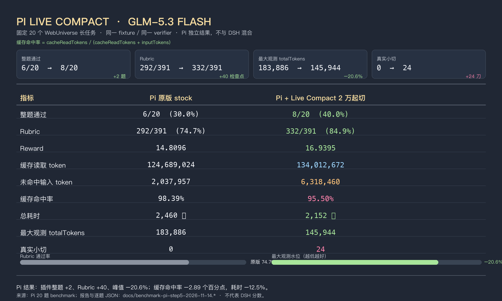

# Pi Live Compact



边做边压的 Pi 扩展。一轮结束就检查刚结束的工具结果。够长就在本机收成卡片，不调用模型。切点前面的原文不动。

对应的 DSH 插件是 [dsh-live-compact](https://github.com/Tranquillitatis-Lab/dsh-live-compact)。当前已发布的是 1.1.5。PR 46 还开着，合并后会是 1.1.6。这个扩展按 1.1.5 的切法来，并带上 PR 46 里「同一调用编号、内容变了就不要切」的那条。

Pi 自己的压缩要等到窗口快满，再调一次模型写摘要。这个扩展不替换那一次大压缩。它只在每轮结束时，把三轮以前的长工具结果收成卡片。

## 安装

```sh
pi install git:github.com/MerkyorLynn/pi-live-compact
```

试一次、不写入配置：

```sh
pi -e git:github.com/MerkyorLynn/pi-live-compact
```

## 怎么切

1. 云端和平时一样，上下文到 4.8 万才开始小切。不到这条线不切。
2. 最近 3 个已经结束的工具轮留原文。当前这条用户消息之后的工具结果不切，避免把这道题里的测试输出切掉。
2. 更早的工具结果少于 1000 token 就跳过，不回头凑。
3. `read` 不少于 1000 token 时，只切这一轮的 `read` 结果，不把旁边的短结果卷进来。
4. 单个结果达到 3.2 万 token，只留指针。
5. 失败结果不切。
6. 已经收过的卡片是地板。不再切它左边的内容。
7. 估算上下文到了 65 万，这一轮不再做小切。
8. 备份写失败，或同一个调用编号对上了另一份正文，这一条不切。
9. 不取消 Pi 自己的窗口压缩。那次摘要负责把上下文留在窗口里。这个扩展只切更早的题里的长工具结果。

卡片开头是 `spine-checkpoint`。原文写到 `~/.pi/agent/live-compact/shadow/<会话>/<调用编号>.txt`，只有自己能读。卡片里不写备份路径。

65 万、3.2 万、1000、保留 3 轮，都沿用 DSH 插件，没有新门槛。

## 还没搬过来的

DSH 的 Windows 权限、预设替换、雷霆摘要、服务商地址判断，不在这个扩展里。Pi 窗口快满时的那次模型摘要仍由 Pi 自己做。
