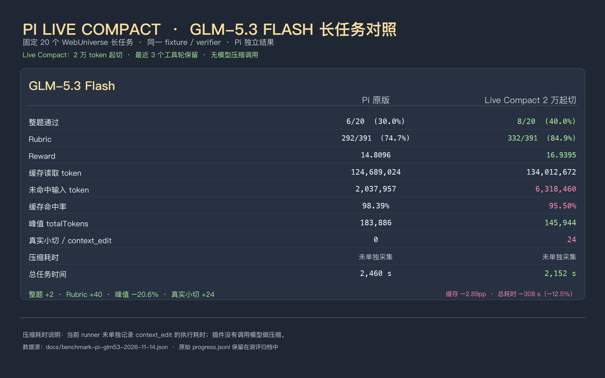

# Pi Live Compact



测评报告： [GLM-5.3 Flash](docs/benchmark-pi-glm53-2026-11-14.md) · [STEP5](docs/benchmark-pi-step5-2026-11-14.md) · [DeepSeek V4.1 Flash](docs/benchmark-pi-dsv41-2026-11-14.md)

边做边压的 Pi 扩展。一轮结束就检查已经持久化的旧工具结果。够长就在本机收成卡片，不调用模型。切点前面的原文不动，最近 3 个工具轮保留原文。

这个扩展和 DSH 使用相同的“本地小切、不调用模型”方向，但运行在 Pi 自己的 `turn_end` / `context_edit` 接口上，版本和数据都独立维护。

Pi 自己的压缩要等到窗口快满，再调一次模型写摘要。这个扩展不替换那一次大压缩。它只在每轮结束时，把三轮以前的长工具结果收成卡片。

## 安装

```sh
pi install git:github.com/MerkyorLynn/pi-live-compact
```

试一次、不写入配置：

```sh
pi -e git:github.com/MerkyorLynn/pi-live-compact
```

## 怎么切

1. 默认上下文到 4.8 万才开始小切；可用 `PI_LIVE_COMPACT_START=20000` 做 2 万起切实验。usage 或窗口未知时不切。
2. 最近 3 个已经结束的工具轮留原文；默认允许同一条用户消息里的更早工具轮被切，保证单个长任务也能降水位。需要冻结最近 user span 时可设置 `PI_LIVE_COMPACT_GUARD_USER_SPANS=1` 做消融。
3. 更早的工具结果少于 1000 token 就跳过，不回头凑。
4. 同一工具轮里每个符合条件的长结果都可以切；`read` 不再阻塞旁边的 `bash` 或其它结果。
5. 单个结果达到 3.2 万 token，会保留调用参数、开头、错误行、末尾摘录和取回原文的方法；结果里有图片时保留图片块。
6. 失败结果不切；已经收过的 toolResult 卡片是地板，不再切它左边的内容。
7. 有窗口信息时按窗口计算起切线，把上界交给 Pi 自己的原生压缩；原生压缩成功或失败后的下一轮跳过一次小切。压缩或分支摘要后如果投影里没有 user 消息，继续保持 fail-closed。
8. 不取消 Pi 自己的窗口压缩。那次摘要负责把上下文留在窗口里。这个扩展只切更早的题里的长工具结果。

卡片开头是 `spine-checkpoint`。持久化会话的原文备份写到 `~/.pi/agent/live-compact/shadow/v2/` 下的原子 JSON 文件，文件名由会话和目标条目哈希生成；卡片里不写备份路径。内存会话不落原文。备份失败只记录日志，不阻塞 context edit。同一个目标条目的正文变化仍然拒绝切割。

事件日志写到 `~/.pi/agent/live-compact/events.jsonl`，也可用 `PI_LIVE_COMPACT_LOG` 指定路径。日志只记录切割判定、压缩事件和错误，不记录工具正文。

## 范围

DSH 的 Windows 权限、预设替换、服务商地址判断不在这个扩展里。Pi 窗口快满时的模型摘要仍由 Pi 自己做。
